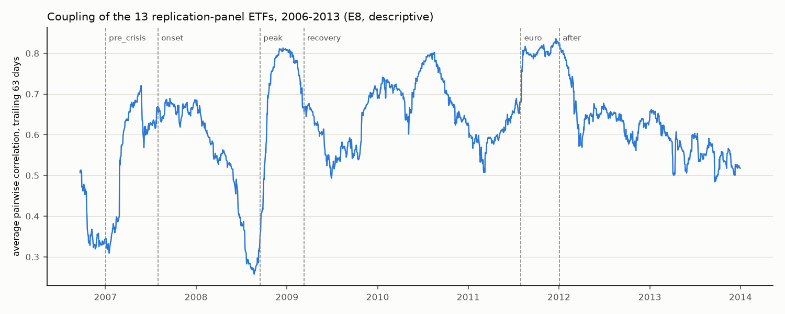
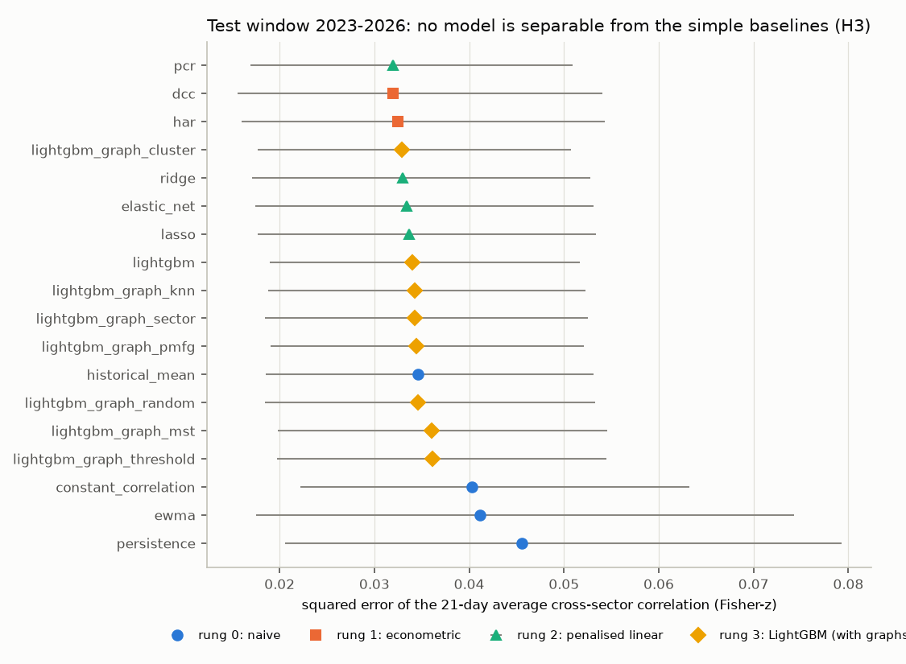
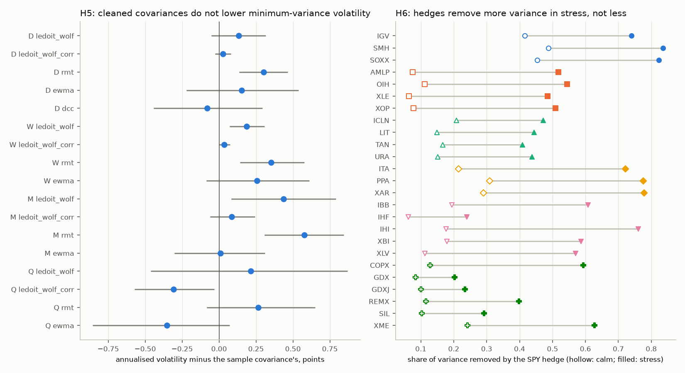

# etf-corr

How are 25 US-listed thematic ETFs (seven sectors) correlated across horizons and regimes, can that
correlation be forecast, and does a better estimate help a portfolio or a hedge? Six hypotheses were
written down and locked before any result existed, then tested once each.

**Result in one line: two of six pre-registered hypotheses held, and one of the two (H4) is a "no
improvement" claim: a graph neural network did not beat LightGBM. Simple, well-known methods were as good
as or better than everything more elaborate, on data no model had seen.** Exploratory follow-ups run after
the verdicts explain the three "opposite sign" results; they change no verdict (see below).

Research code, not investment advice; no claim of tradeable alpha. A portfolio project: historical
data only, no live trading.

## Scoreboard (all six hypotheses, failures included)

| | Hypothesis | Verdict | p | Holm p (m = 6) | Holds after Holm | Window | Caveat |
|---|---|---|---|---|---|---|---|
| H1 | After removing the first eigenmode (market mode), the correlation structure is more similar across horizons (D/W/M) than before removal. | **not supported** | 0.9980 | 1.0000 | no | 2014-01 to 2026-09 (all data), in-sample | significant in the opposite direction (two-sided p 0.004, 0.001, 0.001), but the statistic falls the same way on simulated panels with a horizon-invariant truth (follow-up E2): the test could not tell the directions apart; p derived for the hypothesised direction |
| H2 | Average cross-sector correlation is higher in high-VIX regimes, but a large part of the increase is explained by volatility (Forbes-Rigobon bias) rather than by a true change in dependence. | **supported** | 0.0010 | 0.0060 | yes | 2014-01 to 2026-09 (all data), in-sample | descriptive; the p-value is at the floor of 2000 bootstrap draws; the volatility clause is a pre-fixed threshold, not a test |
| H3 | A machine-learning or graph model beats the best simple baseline (persistence, EWMA, HAR-style, constant correlation) for the 1-month-ahead average cross-sector correlation. | **not supported** | 0.3781 | 1.0000 | no | test 2023-2026, read once | DM-HLN over two challengers; Clark-West gives 0.016 for elastic net against EWMA, but rejects 74% of the time when the baseline is merely badly scaled (follow-up E4) |
| H4 | A temporal graph neural network does not significantly beat a LightGBM model that uses graph-derived features. | **supported** | 0.5966 | 1.0000 | yes | test 2023-2026, read once (2026-11-01) | a non-superiority claim: supported because the network did not beat LightGBM-graph (it was worse, +0.0008); a failure to detect a difference, not proof of equality; designed after the H3 test window had been read |
| H5 | Shrinkage, RMT-cleaned and DCC-forecast covariance estimates give lower out-of-sample realized volatility for minimum-variance portfolios than the raw sample covariance, especially at monthly and quarterly horizons. | **not supported** | 0.9970 | 1.0000 | no | test 2023-2026, read once | the difference has the opposite sign; long-only monthly portfolios of 25 ETFs, where the constraint already shrinks; long-short, nonlinear shrinkage lowers volatility (follow-up E3, on seen data) |
| H6 | Hedge effectiveness (variance reduction) is lower in the worst-decile stress periods than in calm periods. | **not supported** | 1.0000 | 1.0000 | no | test 2023-2026, read once | the difference has the opposite sign, but it is a volatility effect: about zero after a Forbes-Rigobon adjustment, and hedged volatility is higher in stress (follow-up E1); stress is 93 days in a few clusters |

Holm correction over the six confirmatory tests; a hypothesis that was not tested enters with p = 1.
Generated by `scripts/scoreboard_8_6.py` from the recorded results.

## What was found

- **H2, the one that held.** Cross-sector correlation is higher in high-VIX periods (+0.235, 95% interval
  [+0.159, +0.305]) and about 88% of the rise is explained by volatility rather than by a change in
  dependence. In-sample and descriptive, on all the data (2014 to September 2026).
- **H1, uninformative rather than reversed.** The pre-registered statistic (overlap of the leading
  eigenvector) fell after removing the market mode, which reads as the opposite of H1. But it falls the
  same way, by more, on simulated panels whose structure is identical at every horizon: after the market
  mode is removed the remaining eigenvalues are close together and their eigenvectors are unstable. Cluster
  agreement across horizons rises after removal (0.36 to 0.77, daily against monthly), as H1 expected,
  with intervals that include zero.
- **H3, forecasting.** For the 1-month-ahead average cross-sector correlation, 12 machine-learning and
  graph models were compared with simple baselines on 2023-2026 (about 43 independent months). The two
  pre-named challengers had a 17-19% lower loss than EWMA, not distinguishable from zero (p = 0.38), and
  were worse than DCC. A Model Confidence Set kept all 18 models. Graph features added nothing.
- **H4, a graph neural network (run 2026-11-01).** A temporal graph network (a graph convolution feeding
  a GRU per fund) did not beat LightGBM with graph features on 2023-2026: 0.0350 against 0.0343, one-sided p = 0.60, so the
  pre-registered "does not significantly beat" holds. The graph inside the network did nothing (kNN,
  sector and random graphs score 0.0350, no graph 0.0351), and every version was worse than DCC (0.0320). Its
  "support" is a failure to detect a difference, not proof that the two are equal.
- **H5, portfolios.** Shrinkage, RMT-cleaned and DCC covariances gave long-only minimum-variance
  portfolios with slightly *higher* realised volatility than the plain sample covariance (+0.14 points,
  [+0.05, +0.23]). The long-only constraint already acts as shrinkage. In a follow-up with shorting
  allowed, nonlinear shrinkage lowered volatility (by 0.5 points on 2021-2022, more as the estimation
  window gets short against the number of assets), while eigenvalue clipping raised it by 2.6-5.4 points.
- **H6, hedging.** A SPY hedge removed *more* variance in the highest-VIX decile (54%) than in calm
  periods (19%), for every one of the 25 ETFs. This is the same volatility effect as H2, not a better
  hedge: after the Forbes-Rigobon adjustment the gap is -0.04 [-0.08, +0.04], and what is left after
  hedging is *more* volatile in stress (27% against 23% annualised; 38% against 19% in 2016-2022, with
  energy and mining funds still at 55-62%). Quote leftover risk, not the share removed.

The follow-ups (declared as E1-E4 in `config/experiment.yaml`, written up in
`docs/FOLLOW_UPS_RESULTS.md`) were run after the verdicts and partly on the 2023-2026 window, which had
then been read: they are explanations, not confirmations.

**A second, earlier window repeats the verdicts.** H2, H5 and H6 were re-run on 2007-2013, years no
statistic of the project had touched, with the design declared and tagged before the download
(E5-E7, Holm over the three; panel of the 13 core funds that existed in mid-2006, so no clean energy).
H2 holds again (raw +0.197, Holm p = 0.003); cleaned covariances again raise long-only volatility
(+0.17 points); the SPY hedge again removes more variance in stress (+0.21), while what it leaves is
32% volatile in stress against 14% in calm. Through the crisis, the sectors decoupled during its first
year (average correlation 0.43 against 0.61 before) and recoupled within weeks of Lehman; the 2011 euro
crisis was the most coupled phase (0.80). Details and limits: `docs/REPLICATION_PRE2014_RESULTS.md`.

**What H2 left open (E9).** The volatility adjustment in H2 over-corrected and could not say whether
anything beyond volatility changed in stress. A declared follow-up answers it with nine common factors
(Fama-French five, momentum, oil, gold, Treasuries): within each VIX tercile, correlation splits exactly
into a factor part and a residual part. The factors carry 99% of the high-VIX rise (2014-2022), and the
correlation between what they leave behind is about 0.01 in both regimes (+0.009 higher in stress,
[-0.009, +0.028], p = 0.16): across sectors, the stress rise is the common factors, not extra
co-movement. Details: `docs/E9_FACTOR_RESIDUAL_RESULTS.md`.






## Why the nulls can be believed

- **Pre-registration.** H1-H6 and the inference settings are fingerprinted in `config/hypotheses.lock`
  (tag `prereg-v1`; on the tags, see [About this repository](#about-this-repository)); `etfcorr check-config` fails if they are edited.
- **A sealed test window, for every forecast, portfolio and hedge.** 2023-01-01 onward was not read by
  any model, comparator or verdict rule until they were committed and tagged (`final-freeze-v1`,
  `econ-freeze-v1`). The two descriptive statistics (H1, H2) fit no model and were computed on all the data
  through 2026-09-25 in Phases 3 and 4, before that freeze; average correlation levels of 2023-2026 were
  therefore known in aggregate. Each final run writes a marker before
  it reads data and refuses to run twice.
- **Purged walk-forward only.** Every forecast is fitted on origins at least horizon-plus-embargo days
  before the dates it is scored on; tuning happens on inner folds of the training window.
- **Leakage tests with leaky twins.** Features, targets, folds, graphs, portfolio weights and hedge
  ratios go through shared look-ahead detectors, and each detector is shown to catch a deliberately
  leaky version of the code.
- **Every configuration tried is on record**, including design changes made after seeing validation
  results (each declared in the config and tagged before it was run). The counts are below.

## How much was tried

- **Forecasting, validation window.** 6 tasks with up to 11 models each, 4 design variants, 960
  LightGBM tuning trials (Phase 6) and 2240 more for the graph models (Phase 7), and one revision of the
  H3 verdict rule, declared before the test window was read (`docs/explained/04_forecasting_H3_H4.md`).
- **Forecasting, test window.** One run of 18 models on the 21-day target: 6000 LightGBM tuning trials,
  all on inner folds of the training windows, none on test targets. Every stochastic model, the H4
  network included, is averaged over five seeds (0-4).
- **Null benchmark.** 200 pipelines fed random persistent features, scored like the real models on H3's
  target: DCC, HAR and PCA regression rank at the 4th percentile of that null, elastic net at the 9th,
  and EWMA at the 95th (`reports/tables/null_benchmark_8_4.csv`).
- **Portfolios.** Sharpe ratios, deflated Sharpe and the probability of backtest overfitting are computed
  (through `purgedcv`) but are not results, since no hypothesis is a return claim: Sharpe 1.0 to 1.3 with
  a standard error of 0.52, no cell distinguishable from another, and a PBO of 0.80 across cells
  (choosing the in-sample best cell does worse than a coin flip out of sample).

## What did not work

| What was tried | What happened | Where |
|---|---|---|
| H1: horizon similarity after removing the market mode | the statistic moved the "wrong" way, but moves the same way on simulated panels with identical structure at every horizon: the test was uninformative | `docs/H1_FINDINGS.md` |
| H3: machine-learning and graph models against simple baselines | none separable from the baselines (p = 0.38); the Model Confidence Set keeps all 18 models; the validation ranking did not carry over (elastic net first of 18, then sixth) | `docs/explained/04_forecasting_H3_H4.md` |
| Graph features (seven graph kinds) | a small edge on validation, nothing on the test window: the validation ordering (kNN best, random worst) is gone, and in the H4 network a random graph scores like kNN | `docs/explained/04_forecasting_H3_H4.md` |
| H4: temporal graph neural network | no better than LightGBM with graph features, worse than DCC (0.0350 against 0.0320) | `paper.md` |
| H5: cleaned covariance, long-only | realised volatility slightly higher than with the plain sample covariance (+0.14 points) | `docs/explained/05_portfolios_H5.md` |
| Eigenvalue clipping, long-short (E3) | raised volatility by 2.6-5.4 points | `docs/FOLLOW_UPS_RESULTS.md` |
| H6: hedges in stress | the larger share of variance removed in stress is a volatility effect; hedged positions are more volatile in stress | `docs/explained/06_hedging_H6.md` |
| Lead-lag scan (Phase 4, exploratory) | 0 discoveries in 1500 pair-lag cells after Benjamini-Hochberg or -Yekutieli (46 cells below 0.05, 75 expected by chance), daily and weekly; fitted on 2016-2020, test window never read | `docs/explained/03_regimes_H2.md` |
| Hidden Markov regimes (Phase 4, exploratory) | the separation between states is no larger than on row-shuffled copies of the data: a volatility-level tag, not evidence of correlation regimes | `docs/explained/03_regimes_H2.md` |

## What to hold against these results

- **One test window** (2023 to mid-2026), about 43 independent months for the 21-day target. "Not
  supported" means not detected with this sample and these models, not shown to be impossible. The
  economic verdicts (H2, H5, H6) repeat on 2007-2013 (E5-E7); the forecasting ones (H3, H4) were not
  re-tested there.
- **The H3 verdict depends on the test.** Diebold-Mariano (chosen before the test window was read, after
  validation numbers were seen) gives p = 0.38; Clark-West, which a literal reading of the
  pre-registration would use, gives 0.016 for elastic net against EWMA. Calibrated afterwards by
  simulation at these sample sizes, Clark-West is only mildly oversized (7% at a nominal 5%) but fires
  74% of the time when the baseline is merely badly scaled, and EWMA lost to the plain historical mean on
  this window; DM-HLN has little power here. Elastic net beat a poor baseline, not DCC, HAR or the mean.
  A slower EWMA (0.97-0.995) is not a better baseline on the test window.
- **H4 was designed after the test window had been read for H3**, so the comparator's test numbers were
  known; the network was frozen on validation and run once on 2026-11-01.
- **H5 and H6 designs were mine to choose** (long-only monthly portfolios, a single-instrument hedge,
  stress as the top VIX decile of the window); one H5 estimator was replaced on validation by a
  pre-declared rule.
- **Data.** Vendor closes (yfinance, personal-use terms; raw data are not redistributed), survivorship in
  the choice of ETFs, premium/discount to NAV, asynchronous closes and retroactive adjustments are not
  modelled. No futures-based fund enters any economic result. Sharpe ratios in the tables are not results.

## Reproduce

```bash
make setup                       # Python 3.12 venv with the pinned versions in requirements.lock
make test                        # 1821 tests, about 5 minutes
uv run --no-sync etfcorr check-config   # validates the config and the pre-registration lock
make all                         # rebuilds every table and figure from the data on disk (1-2 hours)
```

`make all` needs the price data, which is not in the repository; download it first (below).

The data layer (`etfcorr data download`, `data build`, `returns`) needs network access. The two
test-window runs (`etfcorr eval --final`, `etfcorr econ --final`) have been executed once and are refused
from then on; their outputs are the `*_final_*` files in `reports/tables/`. The same holds for the later
single runs, each guarded by a marker in `reports/tables/`: H4 (`scripts/h4_export.py`, `h4_tgnn.py`,
`h4_score.py`), the 2007-2013 replication (`scripts/replication_pre2014.py`, data in `replication/pre2014`)
and E9 (`scripts/factor_residual_e9.py`, Fama-French factors fetched with `--fetch-factors`). E10
(`scripts/holdout_e10.py`, data in `holdout/post2026`) refuses to run before 2027-10-07.

Data: Yahoo Finance closes through `yfinance` 1.7.0, downloaded on 2026-09-27 (as of 2026-09-25) for the main
panel and on 2026-11-01 (as of 2013-12-31) for the replication; the download logs with checksums are in
`data/raw/` and `replication/pre2014/data/raw/`. Raw prices are not in the repository (personal-use terms).

## Where things are

| Need | File |
|---|---|
| Write-up | `paper.md` |
| Exploratory follow-ups after the verdicts | `docs/FOLLOW_UPS_RESULTS.md` (scripts `scripts/followup_*.py`) |
| Correlation beyond common factors by VIX regime (E9) | `docs/E9_FACTOR_RESIDUAL_RESULTS.md` (`scripts/factor_residual_e9.py`) |
| Pre-2014 replication of H2, H5, H6 and the crisis phases | `docs/REPLICATION_PRE2014_RESULTS.md` (`scripts/replication_pre2014.py`) |
| Full explanation of each topic (setting, literature, scripts, results, interpretation) | `docs/explained/` (start at `00_index.md`) |
| Design and pre-registration | `config/experiment.yaml`, `config/hypotheses.lock` |
| Code | `src/etfcorr/` (data, correlation, features, models, evaluation) |

## About this repository

This is a single-commit snapshot of the private research repository. The git tags and commit hashes cited
in the docs and the config (`prereg-v1`, `final-freeze-v1`, `econ-freeze-v1`, `h4-freeze-v1`,
`replication-freeze-v1`, ...) belong to that private history, which is not published, so the order in
which things were declared can be checked here only through the dates in `config/experiment.yaml`, the
fingerprint in `config/hypotheses.lock` and the single-run markers in `reports/tables/`, not through git.
The step-by-step working notes and the planning documents are not included either; docstrings and a few
docs still cite them by name (`project_plan.md`, `REFERENCES_SEED.md`, `docs/checks/`, `status/`).
