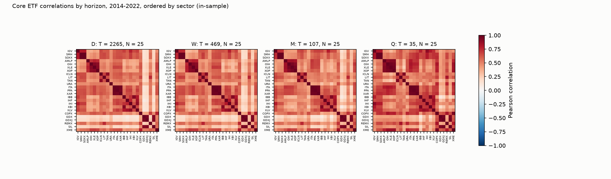

# 1. Data and design

Everything in the other files rests on the choices below: which funds, which prices, which windows, and the
rules that stop a test from seeing its own answer. Phases 0-2 of the project (`status/phase_0.md` to
`phase_2.md`, check reports `docs/checks/0.*` to `2.*`).

## 1.1 Setting

**Question.** How are thematic ETFs correlated across horizons and market regimes; can that correlation be
forecast; and does a better estimate help a portfolio or a hedge?

**Why thematic ETFs.** They package sector stories (semiconductors, clean energy, defence, miners) into
traded baskets. Investors who hold several themes need to know how much the themes really diversify, whether
that changes in a sell-off, and whether a broad-market hedge protects them. This is a question about risk, not
about returns: nothing in the project tries to predict which ETF goes up.

## 1.2 The universe

56 tickers in `config/universe.yaml`, in three panels.

| Panel | Use | Tickers |
|---|---|---|
| **core (25)** | every confirmatory result | ai_semis: SMH, SOXX, IGV · clean_energy: ICLN, TAN, LIT, URA · defense: ITA, XAR, PPA · energy_trad: XLE, XOP, OIH, AMLP · healthcare: XLV, IBB, XBI, IHI, IHF · metals_mining: GDX, GDXJ, XME, COPX, SIL, REMX |
| extended (22) | exploratory sub-panels only | later or less liquid funds (BOTZ, AIQ, CLOU, WCLD, QCLN, FAN, PBW, NLR, SHLD, USO, UNG, VDE, ARKG, PICK) and the fintech/crypto sector (ARKF, FINX, BLOK, IBIT, BITO, BITQ, BTC-USD, ETH-USD) |
| control (9) | market factor, hedges, regimes | SPY, QQQ, IWM, TLT, GLD, HYG, UUP, DBC, ^VIX |

**How the core was chosen** (step 1.1b, Filippo's two rules, applied to every ticker the same way): history
starting at the 2014 download start, and a median daily dollar volume of at least 10 million USD. That leaves
the fintech/crypto sector with no core member, so the core has **six sectors**, not seven. Two more funds (IHF,
REMX) were promoted in step 2.4 because their measured holdings overlap with their sector's other members was
the lowest (0.028 and 0.011 weighted Jaccard).

**Futures-based funds** (USO, UNG, BITO, UUP, DBC) carry roll yield, so none enters an economic result. Their
flags were confirmed on 2026-10-12 from search listings of the SEC filings.

## 1.3 Data pipeline

| Step | Code | What it does |
|---|---|---|
| Audit | `data/universe_check.py`, `etfcorr data check-universe` | Checks each ticker's vendor history, liquidity and metadata against the rules above |
| Download | `data/download.py`, `data/sources.py`, `etfcorr data download` | Daily OHLCV from Yahoo Finance (`yfinance`, personal-use terms), cached per ticker, every download logged with a SHA-256 of the panel |
| Calendar | `data/calendars.py` | NYSE sessions; crypto trades every day and is kept on its own calendar |
| Validation | `data/validate.py` | Hard errors stop the build (missing ticker, non-positive price, stale last bar); soft warnings (5-sigma days, zero-volume days, liquidity) are logged |
| Panel | `data/build_panel.py`, `etfcorr data build` | Aligns every ticker to one NYSE calendar **without forward-filling** and writes `data/interim/prices_clean.parquet` |
| Returns | `returns.py`, `etfcorr returns` | Log returns of adjusted closes at daily (D), weekly Friday (W), month-end (M) and quarter-end (Q) frequency; an incomplete last period is dropped |
| Holdings | `data/holdings.py`, `etfcorr data holdings` | Point-in-time fund holdings from SEC EDGAR N-PORT-P filings, chosen by filing date so the 45-day reporting lag cannot leak |
| Overlap | `correlation/overlap.py` | Weighted Jaccard overlap of holdings, and a regression of return correlation on overlap with a QAP permutation test (Mantel 1967; Krackhardt 1988, as cited in `status/phase_2.md`) |

Result of the build (as of 2026-09-25): 56 tickers, 3202 sessions from 2014-01-02, zero missing values in the
core, 63 warnings, all explained (liquidity and fat-tailed days). Return panels: D 3201, W 664, M 151, Q 49 rows.

Script: `scripts/check_overlap_pairs.py` measured the holdings overlap of candidate pairs. It overturned two
guesses made from fund names: PBW-ICLN (0.06) and PICK-XME (0.08) overlap little, while VDE-XLE (0.69) and
NLR-URA (0.31) overlap a lot. SMH-SOXX overlap 0.58, which is why SOXX is marked as overlapping SMH.

## 1.4 What the correlation matrix looks like

*Figure: `scripts/figures_8_7.py`, 2014-2022, ETFs ordered by sector.* Average pairwise correlation is about
0.50 at every horizon (0.495 daily, 0.501 weekly, 0.500 monthly, `reports/tables/estimator_stability_3_5.md`).
The blocks along the diagonal are the sectors; metals and miners, and energy, form the most distinct blocks.

## 1.5 Splits and the sealed test window

| Window | Dates | Used for |
|---|---|---|
| warm-up | 2014-2015 | trailing features and estimation windows only |
| train | 2016-01-01 to 2020-12-31 | fitting |
| validation | 2021-01-01 to 2022-12-31 | choosing models and design variants |
| **test** | 2023-01-01 to 2026-09-18 | **read once per hypothesis family**, by `etfcorr eval --final` (H3) and `etfcorr econ --final` (H5, H6) |

`splits.py` enforces the seal: `assert_sealed` refuses any validation-mode table that reaches into 2023, and
each final command writes a marker file (`reports/tables/*_final_marker.json`) before reading data and refuses
to run again. H1 and H2 are descriptive statistics with no fitted model, so they use the full
sample (2014 to 2026-09-25) and are labelled in-sample; they were computed before the Phase 7 freeze.

## 1.6 Rules every test follows

- **Pre-registration.** H1-H6 and the inference settings are fingerprinted into `config/hypotheses.lock` (tag
  `prereg-v1`); `etfcorr check-config` fails if they change. Later design choices are written in the config
  with a date, and committed and tagged before they run (`design-v1` to `design-v4b-declared`,
  `final-freeze-v1`, `econ-freeze-v1`). Exploratory work after the verdicts is declared as E1-E4.
- **Inference.** Alpha 0.05; Politis-Romano (1994) stationary bootstrap with 2000 draws; Holm (1979) across
  the six confirmatory tests.
- **Purged walk-forward only.** Every forecast is made at a date by a model fitted on targets that were fully
  known by then: the training set ends at least the forecast horizon plus a five-day embargo before the test
  date (`splits.py`; folds checked against `purgedcv.purge`). Models are refitted every quarter on an
  expanding window.
- **Leakage tests with leaky twins.** `tests/leakage/` (22 files) checks every function that turns data into a
  feature, target, regime label, graph, weight or hedge ratio: truncating the data or replacing the future
  must not change any value dated before the cut. Each detector is shown to catch a deliberately leaky copy of
  the code.
- **Every configuration tried is on record**, so the multiple-testing count used in Phase 8 is real.

## 1.7 Correlation estimators (step 2.2, used everywhere)

`correlation/estimators.py` offers Pearson, Spearman, Kendall, Ledoit-Wolf (2004) linear shrinkage, OAS and
EWMA behind one function, `estimate(returns, method)`, always on complete rows (never pairwise-complete, which
can produce a matrix that is not a valid correlation matrix). EWMA uses the RiskMetrics (1996) recursion with
decay 0.94, the project's single convention wherever volatility or correlation is a nuisance input
(`ewma_lambda` in the config).

## 1.8 Limits that apply to every file

- One vendor (Yahoo Finance), close-to-close prices; a bad tick that is otherwise consistent passes undetected
  (no second source).
- Survivorship: the funds were chosen in 2026 from those that exist now.
- Premium or discount to NAV, asynchronous closes (crypto closes at midnight UTC) and retroactive price
  adjustments are not modelled.
- Raw vendor data are never committed or redistributed; only derived results are.
