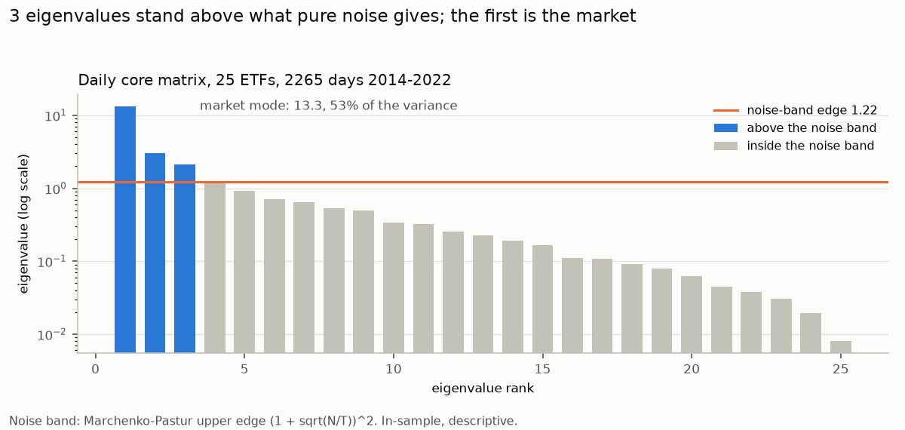
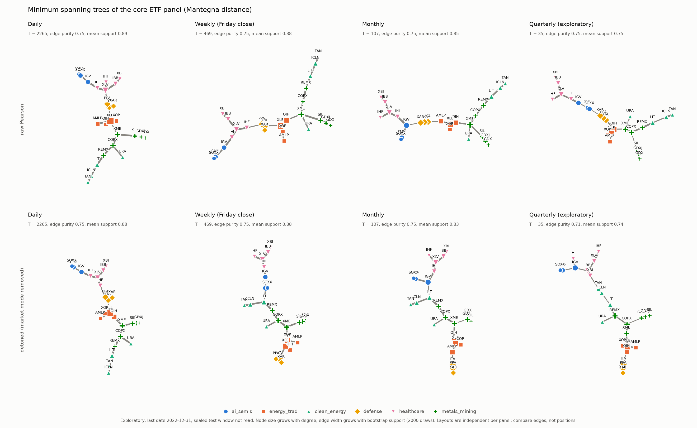
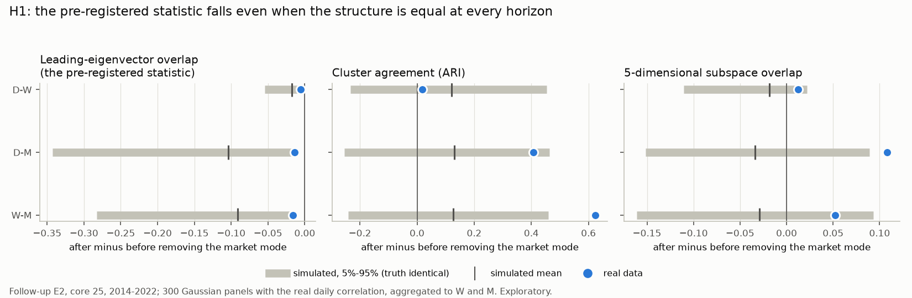

# 2. Correlation structure across horizons (H1)

Phase 3 (`status/phase_3.md`, `docs/H1_FINDINGS.md`, `docs/METHOD_ROBUSTNESS.md`, check reports `3.1`-`3.4`)
and follow-up E2 (`docs/FOLLOW_UPS_RESULTS.md`).

**Verdict: not supported** (all the data, 2014-01 to 2026-09, in-sample; T = 3201 daily rows). The pre-registered statistic moved the opposite way, but a
follow-up shows that the statistic would have moved that way even if H1 were true: the test was uninformative.

## 2.1 Setting

**H1 (pre-registered).** After removing the first eigenmode (the market mode), the correlation structure is
more similar across horizons (daily, weekly, monthly) than before removal.

**Why it matters.** If the structure left after the market is the same at every horizon, a risk model fitted
on plentiful daily data can be used for monthly decisions, where data are scarce (107 monthly rows in
2014-2022 for 25 funds). If it is not, horizon-specific models are needed.

**Test (pre-registered).** Similarity of the D, W and M correlation matrices for each pair of horizons, before
and after removing the market mode, by two metrics (Frobenius distance; overlap of the leading eigenvector),
with stationary-bootstrap intervals on the after-minus-before difference. Core panel (23 funds at the time of
the test), all the data 2014-01 to 2026-09 (T = 3201 / 664 / 151 rows), 2000 bootstrap draws.

## 2.2 Literature

- **Most of an empirical correlation matrix is noise.** Laloux et al. (1999) and Plerou et al. (2002) found
  that most eigenvalues of stock correlation matrices fall inside the range predicted for a purely random
  matrix (Marchenko and Pastur 1967); a few lie above it. The largest is the **market mode**, a roughly
  equal-weighted move of everything; the next few correspond to groups such as industries.
- **Market-mode removal ("detoning").** Subtracting the market mode leaves a matrix that describes how assets
  co-move *relative to the market*. Borghesi, Marsili and Miccichè (2007) find that, once the market mode is
  removed, the **cluster structure** of 100 NYSE stocks (and of London, Paris and Milan stocks) in 2002 is
  essentially the same from 5-minute to daily returns: over 90% information overlap between the clusterings,
  about 80% of the sector information, constant across horizons (p. 1, 5-6 of the arXiv version). They remove
  the market by subtracting the average return or regressing on it or on a single fitted factor (p. 3); the
  fitted-factor version equals subtracting the leading singular-value component, essentially what
  `detone_corr` does. They compare clusterings and tree degree distributions (p. 7), not eigenvectors. H1 takes
  their idea to daily, weekly and monthly ETF returns and tests it with a different statistic (see 2.5 and
  file 08).
- **Hierarchical structure.** Mantegna (1999) turned a correlation matrix into a distance, built the minimum
  spanning tree (MST), and found that it recovers an economically meaningful taxonomy of stocks. The distance is
  `sqrt(2 (1 - rho))` (equation 2 of the published article, as in `networks.py`; the arXiv preprint had
  `1 - rho^2`, file 08, 8.2).
- **Comparing partitions.** The adjusted Rand index (Hubert and Arabie 1985) measures agreement between two
  clusterings, corrected so that chance agreement scores about 0.
- **Shrinkage.** Ledoit and Wolf (2004) pull the sample covariance towards a structured target to make it
  better conditioned; used here in the estimator-stability table.

## 2.3 Code

| Module | What it does |
|---|---|
| `correlation/rmt.py` | Marchenko-Pastur upper edge, eigen-spectrum diagnostics (number of signal eigenvalues, market-mode share, effective number of bets), denoising (eigenvalues below the edge replaced by their mean) and detoning (top mode subtracted, rescaled to unit diagonal) |
| `correlation/horizon_analysis.py` | The H1 engine: Frobenius distance, leading-eigenvector overlap (mean squared cosine of the principal angles), before/after comparison, stationary bootstrap, `h1_cross_horizon_test` |
| `correlation/networks.py` | Mantegna distance, Kruskal MST, centralities, hierarchical clusters, edge-survival ratio, sector-purity permutation test |
| `correlation/network_stability.py` | Bootstrap edge support, noise floors, cluster-to-sector agreement; `partition_similarity` (added for E2) |
| `correlation/stability.py` | Bootstrap spread of eight correlation estimators |
| `correlation/nonlinear.py`, `tail.py` | Distance correlation, mutual information, tail dependence (built in step 3.4, checked against `dcor`; not used for a result) |

## 2.4 Scripts and results

### `scripts/exploratory_3_1.py`: the spectrum of the real matrix

Daily core matrix (T = 3201, 25 funds): Marchenko-Pastur edge 1.18, **four eigenvalues above it**, top
eigenvalues 12.4, 2.93, 2.2; the market mode alone carries **about half the variance** (share 0.50); effective
number of independent bets about 7.

*Figure: `scripts/figures_explained.py`, daily core matrix 2014-2022 (T = 2265). On this shorter window the
noise edge is 1.22 and three eigenvalues clear it (the fourth, 1.19, sits just below); on the full sample
(T = 3201, edge 1.18) four do.*

After detoning, 82.5% of cross-sector pairs turn negative and almost no
within-sector pair does: detoned correlations are relative, not absolute. Quarterly (T = 49): edge 2.94, two
signal eigenvalues.

### `scripts/eigenvector_loadings_3_2.py`: what the signal modes are

The second eigenvector (12.3% of the trace, daily) loads on the gold and silver miners (GDX +0.50, GDXJ +0.49,
SIL +0.48) against healthcare. At the quarterly horizon the leading residual mode is energy instead. The
leading residual mode is a different sector at different horizons, consistent with Plerou et al. (2002), who
read signal eigenvectors as industry groups.

### `scripts/exploratory_3_2.py` and `scripts/h1_table_3_2.py`: the H1 verdict

| Pair | Eigenvector overlap, before -> after | Difference [95%] | Two-sided p | Frobenius difference [95%] |
|---|---|---|---|---|
| D-W | 0.998 -> 0.944 | -0.054 [-0.974, -0.008] | 0.004 | -0.10 [-0.65, +1.23] |
| D-M | 0.995 -> 0.954 | -0.042 [-0.982, -0.019] | 0.001 | -0.24 [-0.96, +1.24] |
| W-M | 0.998 -> 0.964 | -0.034 [-0.986, -0.029] | 0.001 | -0.45 [-1.10, +1.23] |

Positive differences would support H1. The eigenvector overlap fell after detoning in all three pairs,
significant after Holm within the metric and across all six tests; the Frobenius metric shows nothing.
`scripts/h1_nmarket_signal_3_2.py` removes each horizon's own number of signal modes instead of one: the
differences stay negative (-0.031, -0.061, -0.031). **Verdict: not supported.** For the H1-H6 scoreboard the
one-sided p-value in the hypothesised direction is derived as 0.998.

### Method checks: `null_calibration_real_dims_3_2.py`, `frobenius_bias_nmarket_3_2.py`, `bootstrap_joint_vs_independent_3_2.py`

On pure-noise panels of the real size, the Frobenius difference is biased away from zero by the rescaling
after detoning, so it cannot be read as evidence; the eigenvector metric is well calibrated **when the truth is
noise** (bias about +-0.01-0.03). Resampling the horizons jointly narrows the Frobenius interval by about 20%
but not the eigenvector one. Details: `docs/METHOD_ROBUSTNESS.md`.

### `scripts/estimator_stability_3_5.py`: how stable each estimator is

`reports/tables/estimator_stability_3_5.md`, 2014-2022, 500 bootstrap draws. Average correlation is 0.49-0.50
for Pearson, Ledoit-Wolf, OAS and denoised at every horizon (Spearman 0.44, Kendall 0.32, as those scales
are lower by construction). Its bootstrap spread grows as the data get shorter: 0.03 daily, 0.04 weekly,
0.05 monthly, 0.085 quarterly. EWMA is far less stable (spread 0.08-0.11), because it mixes time variation
with sampling error. Denoising cuts the condition number from about 1650 to 51 at the daily horizon.
Descriptive: a lower spread is not a more accurate estimate.

### `scripts/mst_figure_3_6.py`: the trees and their stability

*Rows: raw and detoned matrix; columns: D, W, M, Q; colour and marker = sector; edge width = bootstrap
support. 2014-2022.* From `reports/tables/mst_summary_3_6.md`:

| Horizon | Same-sector edges (null) | Cluster-sector ARI, raw -> detoned | Mean edge support |
|---|---|---|---|
| D | 75% (14%) | 0.40 -> 0.62 | 0.88 |
| W | 75% (14%) | 0.38 -> 0.78 | 0.88 |
| M | 75% (14%) | 0.59 -> 0.78 | 0.85 |
| Q | 75% / 71% (14%) | 0.37 -> 0.57 | 0.75 |

Three quarters of the tree's edges join funds of the same sector, against 14% if sectors were random. After
detoning, clusters match the sectors better at every horizon. Trees of different horizons share 63-88% of
their edges, far above the noise floor of 17%.

### `scripts/followup_h1.py` (follow-up E2): was the test able to answer?

Core 25 funds, 2014-2022. The H1 statistic is recomputed beside statistics that do not depend on the order of
close eigenvalues, and all are recomputed on 300 simulated panels per world with the real size and **a
structure that is identical at every horizon**. In the truth of those panels every similarity is 1 before and
after. `real_corr`: Gaussian with the real daily correlation matrix. `factor`: one market factor plus sector
factors. Tables: `reports/tables/followup_h1_{real,simulated}.csv`.

| Daily vs monthly | Real data | Simulated, `real_corr` (mean, 5%-95%) |
|---|---|---|
| Leading-eigenvector overlap, after - before | -0.014 | -0.104 (-0.343 to -0.014) |
| Cluster ARI, before / after | 0.36 / 0.77 | 0.66 / 0.79 |
| Cluster ARI, after - before | +0.41 [-0.27, +0.54] | +0.13 (-0.25 to +0.46) |
| 5-dimensional subspace overlap, after - before | +0.108 [-0.068, +0.146] | -0.034 (-0.151 to +0.089) |

*Figure: `scripts/figures_explained.py`. Grey bar: where 90% of the simulated differences fall when the truth
is identical at every horizon; blue dot: the real difference. Left panel: the real values sit at the top of a
range that lies entirely below zero.*

Note: the verdict used the 23-fund panel, where the daily-weekly drop was 0.998 to 0.944; on the 25-fund panel
it is 0.998 to 0.992.

## 2.5 Interpretation

**The H1 statistic could not have supported H1.** After the market mode is removed, the remaining eigenvalues
are close together (2.9, 2.2, 1.2, ...). Plerou et al. (2002) measured exactly this: the top two or three
eigenvectors of a stock correlation matrix are stable over time, and stability falls as an eigenvalue approaches
the noise edge (p. 2, 9 of the arXiv version). When two eigenvalues are close, which eigenvector comes first flips
with small sampling changes, so the "leading residual eigenvector" of the daily matrix and of the monthly
matrix can differ even when the underlying structures are identical. The simulation confirms it: with an
identical structure at every horizon, the statistic drops by 0.10 on average, more than in the real data.
The earlier calibration that found the statistic well behaved used pure-noise panels, whose eigenvalues are not
arranged this way. The honest reading is "the pre-registered test could not distinguish the directions", not
"the opposite of Borghesi et al. was found".

**Statistics that do not depend on eigenvector order lean towards H1.** Cluster partitions agree more across
horizons after detoning (0.36 to 0.77, daily against monthly), and so does the five-dimensional subspace. Both
sit at the 90th-97th percentile of the simulated panels, with intervals that include zero. The MST table
points the same way: detoning raises the agreement between clusters and sectors at every horizon, though
Borghesi et al. found market-removed trees of 100 stocks indistinguishable from noise (p. 8), so trees of 25
funds are weak evidence. This is consistent with Borghesi et al. (2007), whose own measure was a comparison of
cluster structures, and who also saw stable cluster membership with a shifting order of clusters across
horizons (p. 5), as here; but it is not established here.

**What is solid.** The market mode carries about half the variance and is what is stable across horizons;
the sector blocks are real (MST purity 75% against 14%, edge support 0.85-0.88); and the residual structure
differs in which sector dominates at which horizon (miners daily, energy quarterly).

## 2.6 Limits

- In-sample, all the data to 2026-09 (the follow-up E2 uses 2014-2022 only); one universe of 25 funds.
- Whole-sample point estimates; horizons resampled independently in the bootstrap (conservative).
- The verdict panel (23 funds) and the follow-up panel (25) differ.
- The follow-up's two order-robust statistics were chosen after the verdict; they are explanations, not a
  re-test.
