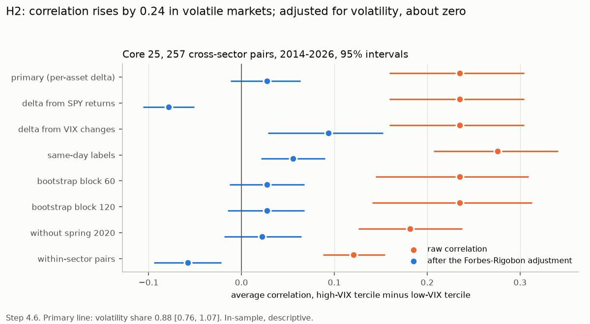
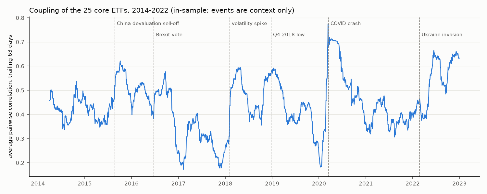
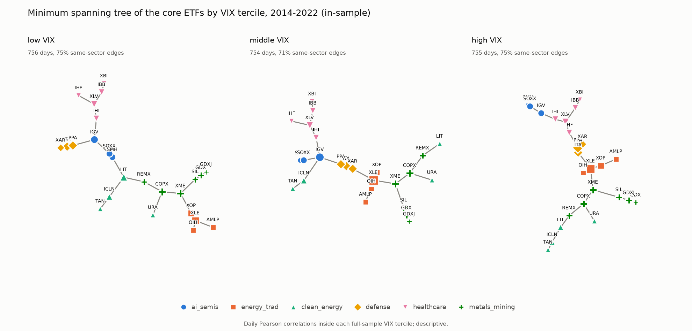

# 3. Correlation in calm and volatile markets (H2)

Phase 4 (`status/phase_4.md`, check reports `4.1`-`4.6`) and two figures added on 2026-10-12.

**Verdict: supported** (full sample, in-sample and descriptive). The one hypothesis of six that held.

## 3.1 Setting

**H2 (pre-registered).** Average cross-sector correlation is higher in high-VIX regimes, but a large part of
the increase is explained by volatility (the Forbes-Rigobon bias) rather than by a true change in dependence.

**Why it matters.** "Correlations go to one in a crisis" is the usual reason diversification is said to fail
when it is needed. If most of the rise is a mechanical effect of higher volatility, the underlying dependence
between sectors is more stable than raw numbers suggest, and a risk model should treat volatility and
correlation separately.

**Test (pre-registered).** Raw versus volatility-adjusted average cross-sector correlation by VIX tercile, with
stationary-bootstrap intervals. The reading rule was fixed on 2026-10-02, before the verdict step: clause 1,
the raw high-minus-low difference is positive with a 95% interval above zero; clause 2, the share of it
explained by volatility is at least 0.5.

## 3.2 Literature

- **The volatility bias.** Forbes and Rigobon (2002) show that a correlation measured in a high-volatility
  period is biased upwards even when the underlying relationship is unchanged, because conditioning on high
  variance of one series raises its measured correlation with others. Their adjustment, with
  `delta = Var(high) / Var(low) - 1`:

  `rho* = rho / sqrt(1 + delta * (1 - rho^2))`

  The project confirmed the square root by derivation and a 2,000,000-draw simulation (a web summary had
  printed the formula without it). The adjustment assumes no omitted common factor and no feedback.
- **Conditional correlation in tails.** Longin and Solnik (2001) show that, under normality with constant
  correlation, the correlation measured on large returns differs from that on small returns, and that the
  correlation of large *negative* returns in equity markets is much higher than normality predicts. Boyer,
  Gibson and Loretan (1999, Federal Reserve IFDP 597) make the same conditioning point.
- **Regime models.** Hamilton (1989) introduced Markov-switching regimes, the basis of the hidden Markov model
  used as a side study.
- **Time-varying correlation.** Engle (2002) introduced dynamic conditional correlation (DCC): GARCH(1,1)
  volatilities (Bollerslev 1986) for each asset, then a recursion for the correlation of the standardised
  returns.
- **Lead-lag.** Lo and MacKinlay (1990) documented that some stocks' returns lead others'; false discoveries
  across many pairs are controlled with Benjamini-Hochberg (1995) and Benjamini-Yekutieli (2001).

## 3.3 Code

| Module | What it does |
|---|---|
| `regimes.py` | VIX-tercile and SPY-drawdown regime labels; `expanding` (causal) and `full_sample` (descriptive) modes; label lagging |
| `correlation/regime_correlation.py` | The H2 engine: average cross-sector correlation by regime, raw and Forbes-Rigobon adjusted with per-asset delta, bootstrap intervals, `vol_share` |
| `correlation/h2_verdict.py` | The reading rule as pure, tested functions |
| `correlation/regime_factor.py` | Exploratory factor decomposition: what correlation would be if only factor variance changed |
| `regime_hmm.py` | Exploratory forward-filtered two-state hidden Markov model (own Baum-Welch, refit every 63 days) |
| `correlation/dcc.py` | Causal DCC with Student-t GARCH(1,1), expanding refits every 63 days, multi-step forecasts; cross-checked against `arch` |
| `correlation/lead_lag.py`, `lead_lag_diagnostics.py` | Exploratory lead-lag scan with false-discovery control |

## 3.4 Scripts and results

### `scripts/exploratory_4_1.py`: the regime labels

VIX 2014-2026: minimum 9.1, maximum 82.7. Full-sample terciles cut at 14.43 and 18.77, giving about 1067 days
each but only **101, 208 and 108 separate episodes**; the longest high-VIX run lasts 279 days. Causal
(expanding) labels drift: later VIX levels exceed cut-points learned in calm years, so 45% of days end up
"high". The number of episodes, not of days, limits what H2 can say.

### `scripts/h2_calibration_4_2.py`: does the adjustment work on known truths?

120 simulated panels of the real shape. When only factor variance rises, the per-asset adjustment removes
51-68% of the rise (it under-corrects); a market-based delta removes 89-102%. When dependence also rises, the
market delta over-attributes to volatility. The interval for a zero raw difference rejects in 6-7 of 120 at a
nominal 5%. So the chosen per-asset adjustment is, if anything, conservative for clause 2.

### `scripts/exploratory_4_2.py` and `scripts/h2_table_4_6.py`: the H2 table and verdict

Core 25, 3201 days (2014-2026), 257 cross-sector pairs, labels known the day before, 2000 draws.
`reports/tables/h2_table_4_6.csv`, `h2_verdict_4_6.json`.

| Line | Raw high - low | Adjusted high - low | Share explained by volatility |
|---|---|---|---|
| **Primary (per-asset delta)** | **+0.235 [+0.159, +0.305]** | +0.027 [-0.011, +0.064] | **0.884 [0.761, 1.065]** |
| VIX-change delta | +0.235 | +0.094 [+0.028, +0.152] | 0.602 [0.435, 0.829] |
| SPY-return delta | +0.235 | -0.078 [-0.106, -0.051] | 1.333 (overshoot) |
| Same-day labels | +0.276 | +0.055 | 0.799 |
| Without spring 2020 | +0.182 | +0.022 | 0.879 |
| Mean block 60 / 120 days | +0.235 | +0.027 | 0.884 (wider intervals) |

*Figure: `scripts/figures_explained.py`, from `h2_table_4_6.csv`. Orange: the raw rise; blue: what is left
after the volatility adjustment. Only the primary line is the verdict; the others are robustness lines.*

Raw average correlation by tercile: 0.280 (low), 0.324 (mid), 0.515 (high). Clause 1 met (p = 0.0010, the
floor for 2000 draws); clause 2 met (0.884 >= 0.5). **Verdict: supported.** The 4.2 numbers were known before
the verdict step encoded the rule; the rule itself was fixed before them.

### `scripts/exploratory_4_2b.py`: a factor-model cross-check (exploratory)

If only the variance of SPY changed between low and high VIX, correlation would have risen by 1.77 times the
observed rise; with SPY plus four latent factors, 1.20 times. Idiosyncratic variance also rose (2.1 times) and
loadings fell slightly, which offsets part of it. No variant finds a rise in dependence that volatility does
not account for.

### `scripts/hmm_calibration_4_3.py` and `scripts/exploratory_4_3.py`: hidden Markov regimes (exploratory)

On simulated data with **no** regimes, the HMM still reports two persistent, well-separated states (stay
probability about 0.98). On real data it finds a calm and a stress state with stay probability 0.996 each, but
their separation lies inside the range of five row-shuffled copies. **Reading:** a filtered volatility tag, not
evidence of distinct correlation regimes.

### `scripts/dcc_calibration_4_4.py`, `exploratory_4_4.py`, `dcc_crosscheck_4_4.py`, `garch_bound_4_4.py`: DCC (exploratory)

The DCC recovers planted parameters on simulated data and matches `arch` on every GARCH fit (largest parameter
gap 2e-5). On real data the correlation dynamics are slow (a + b up to 0.99, shock half-life about 28 days).
By VIX tercile, the DCC average correlation is 0.380 / 0.370 / 0.411, a high-minus-low gap of +0.031 against
+0.162 for EWMA correlation. DCC standardises each return by its own GARCH volatility before measuring
correlation, so this is the same message as H2 from another model. AMLP's GARCH sits at the persistence bound
in 38 of 43 refits; dropping it changed nothing (variant R2, `04_forecasting_H3_H4.md`).

### `scripts/lead_lag_calibration_4_5.py`, `exploratory_4_5.py`, `diagnose_4_5b.py`: lead-lag (exploratory)

1500 tests (pairs and lags 1-5 days) on 2016-2020, replication on 2021-2022, test window never read. 46 cells
below p = 0.05 against 75 expected by chance; **zero discoveries** after Benjamini-Hochberg or
Benjamini-Yekutieli, also at weekly frequency and in rank and clipped variants. The smallest detectable effect
was a lag-1 cross-correlation asymmetry of about 0.21. No usable lead-lag.

### `scripts/figures_followup.py`: coupling over time and trees by regime (descriptive, 2014-2022)

The 63-day average pairwise correlation ranges from 0.17 (February 2017) to 0.77 (12 March 2020), median
0.44. It rises with every marked stress event and decays over months. The event dates were written from
memory and are *Unverified*; they are context, not a test.

| VIX tercile | Days | Same-sector edges | Mean edge correlation |
|---|---|---|---|
| low | 756 | 75% | 0.70 |
| middle | 754 | 71% | 0.76 |
| high | 755 | 75% | 0.85 |

The low- and high-VIX trees share 18 of 24 edges: the shape of the network barely changes; its links get
stronger.

### `scripts/replication_pre2014.py` (E5, E8): the same question on 2007-2013

Declared and tagged before any price before 2014 was downloaded, run once on 2026-11-01
(`docs/REPLICATION_PRE2014_RESULTS.md`). Panel: the 13 core funds that traded by mid-2006 (no clean energy; SMH
and OIH left out, HOLDRS baskets until December 2011). VIX terciles of 2007-07-02 to 2013-12-31, the step 4.6 rule
unchanged.

| Line | Raw high-minus-low | Adjusted | Volatility share |
|---|---|---|---|
| primary (per-asset delta) | +0.197 [+0.120, +0.261] | -0.100 [-0.151, -0.044] | 1.51 [1.18, 2.10] |
| H2, 2014-2026 (primary) | +0.235 [+0.159, +0.305] | +0.027 [-0.011, +0.064] | 0.88 [0.76, 1.07] |

Supported again (Holm p 0.003 over the three replication tests). The adjustment overshoots more than in H2:
SPY's daily variance in the top VIX decile of 2007-2013 is 21 times its calm level.

E8 describes the crisis by fixed calendar phases (descriptive, intervals drawn within each phase):

| Phase | Average cross-sector correlation | Change vs pre-crisis |
|---|---|---|
| pre-crisis (2007-01 to 07) | 0.614 | - |
| onset (2007-08 to 2008-09-12) | 0.432 | -0.18 [-0.33, -0.03] |
| peak (Lehman to 2009-03-09) | 0.750 | +0.14 [+0.01, +0.24] |
| recovery (to 2011-07) | 0.609 | -0.01 [-0.11, +0.11] |
| euro crisis (2011-08 to 12) | 0.803 | +0.19 [+0.10, +0.28] |
| after (2012-13) | 0.546 | -0.07 [-0.16, +0.03] |

The 63-day coupling fell to 0.26 on 2008-08-22, three weeks before Lehman, and was back to 0.81 by
2008-12-16 (`reports/figures/replication_pre2014_coupling.png`).

### `scripts/factor_residual_e9.py` (E9): what is left beyond common factors

Declared and tagged before it was run, run once on 2026-11-01 (`docs/E9_FACTOR_RESIDUAL_RESULTS.md`). Within each
VIX tercile of 2014-2022, each core fund is regressed on nine factors (Fama-French five, momentum, USO, GLD, TLT);
the average cross-sector correlation then splits exactly into a factor part and a residual part.

| 2014-2022 | Low VIX | High VIX | High - low |
|---|---|---|---|
| raw correlation | 0.278 | 0.533 | +0.256 [+0.166, +0.333] |
| factor part | 0.273 | 0.525 | +0.252 |
| residual correlation (the test) | 0.006 | 0.016 | +0.009 [-0.009, +0.028], p = 0.158 |

Not supported: the factors carry 99% [96%, 102%] of the rise, and nothing measurable is left between sectors.
2023-2026 reads the same (+0.017 [-0.016, +0.048]).

## 3.5 Interpretation

**Correlation does rise in volatile markets, by about 0.24, and almost all of the rise is volatility.** After
the Forbes-Rigobon adjustment the gap is +0.027 with an interval that includes zero; a factor model, the DCC
and the tree shapes all tell the same story. This is the Forbes and Rigobon (2002) result ("no contagion, only
interdependence") reproduced on thematic ETFs, and it fits Longin and Solnik's (2001) point that conditioning
on large moves changes measured correlation.

**What "supported" does not mean.** It does not say dependence is unchanged. The non-volatility part is not
identified: across the three adjustments it changes sign (+0.094, +0.027, -0.078). The 0.5 threshold is a
convention. And the share can exceed 1 (an overshoot, not "more than everything explained"). E9 answers the
open part without the adjustment: across sectors, the stress rise is carried by the common factors (their
variances and betas), with no measurable co-movement beyond them. Corsetti, Pericoli and Sbracia (2005) explain
the overshoot: the adjustment treats the whole variance rise as common, while idiosyncratic variance also rose.

**Why this matters for the rest of the study.** The same mechanism explains the H6 hedging result
(`06_hedging_H6.md`): a market hedge removes a larger share of variance in stress because the market explains
a larger share of everything when volatility is high.

## 3.6 Limits

- In-sample, full-sample terciles (cut-point error not propagated); about 100 high-VIX episodes. The
  replication (E5) is on 2007-2013, a window no statistic had touched, but with 13 funds and verdicts known.
- The adjustment assumes no omitted factor and no feedback (Forbes and Rigobon's own assumptions).
- HMM, DCC, factor and lead-lag results are exploratory side studies, not tests of H2.
