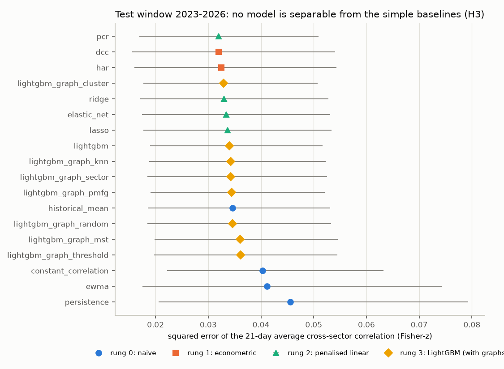
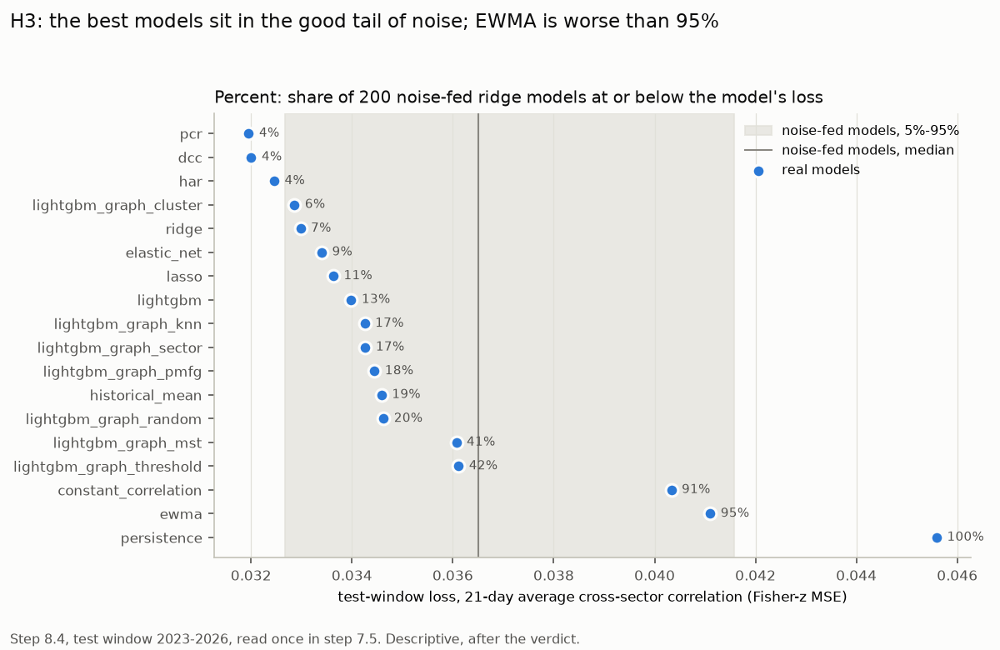

# 4. Forecasting next month's correlation (H3, H4)

Phases 5-7 (`status/phase_5.md` to `phase_7.md`, check reports `5.1`-`7.5`), the null benchmark of step 8.4,
and follow-up E4.

**H3 verdict: not supported** (test window 2023-2026, read once). **H4 verdict: supported** (run once on the
same window on 2026-11-01): the graph neural network did not beat LightGBM with graph features.

## 4.1 Setting

**H3 (pre-registered).** A machine-learning or graph model beats the best simple baseline (persistence, EWMA,
HAR-style, constant correlation) for the 1-month-ahead average cross-sector correlation.

**H4 (pre-registered).** A temporal graph neural network does not significantly beat a LightGBM model that
uses graph-derived features.

**Why it matters.** If next month's correlation can be forecast, diversification can be planned: a portfolio or
hedge can be adjusted before correlations rise rather than after. A claim that machine learning does this
needs to beat the simple methods a risk desk already uses.

**Target.** T1 at 21 days: the average correlation over all 257 cross-sector pairs, measured on the next 21
trading days, in Fisher-z units (z = atanh(rho)); loss is the squared error. Forecasts are made every trading
day, so consecutive targets overlap: 910 test dates hold about 43 independent months. Secondary targets, not
part of H3: T1 at 63 days, the full correlation matrix (T1_matrix), each fund's variance (T2, loss QLIKE) and
the cross-sectional ranking of returns (T3, rank IC).

**Test (as frozen before the test window was read, `docs/checks/7.4.md`).** Two challengers, elastic net and
the kNN-graph LightGBM (the best rung 2-3 models on validation), each against EWMA (the best of the four
baselines H3 names, on validation) by a one-sided Diebold-Mariano test with the Harvey-Leybourne-Newbold
correction, Bonferroni factor 2. DCC is reported as a stricter comparator; Clark-West and a Model Confidence
Set are reported beside the verdict.

## 4.2 Literature

- **Comparing forecasts.** Diebold and Mariano (1995) test whether two forecasts have equal expected loss,
  allowing autocorrelated loss differences; Harvey, Leybourne and Newbold (1997) correct it for small samples
  and multi-step horizons. For nested models, where the larger one contains the smaller, Clark and West (2007)
  adjust the larger model's loss for the noise of estimating parameters whose true value is zero. Hansen, Lunde
  and Nason (2011) build a Model Confidence Set: the set of models that contains the best one with a given
  confidence; uninformative data give a large set.
- **Baselines.** EWMA from RiskMetrics (1996, decay 0.94 for daily data); constant correlation from Elton and
  Gruber (1973); HAR from Corsi (2009), a regression on daily, weekly and monthly averages; DCC from Engle
  (2002); the historical mean as the benchmark of out-of-sample R squared (Campbell and Thompson 2008).
- **Volatility loss.** QLIKE is one of the loss functions whose model ranking is robust to a noisy volatility
  proxy (Patton 2011).

## 4.3 Code

| Module | What it does |
|---|---|
| `targets.py` | Forward targets: each is "the trailing statistic read h days later" |
| `features.py` | Trailing (21/63/126/252-day), EWMA and Spearman correlations in Fisher-z; within-sector correlation; market-mode share; realised variances; dispersion; SPY and VIX columns. All causal |
| `splits.py` | Sealed window; expanding walk-forward folds refitted quarterly with purge (horizon) and embargo (5 days); inner purged folds for tuning |
| `models/baselines.py`, `har.py`, `linear.py`, `gbm.py`, `graphs.py` | Rung 0: persistence, historical mean, EWMA, constant correlation; rung 1: HAR, DCC; rung 2: ridge, lasso, elastic net, PCA regression (tuned on inner folds); rung 3: LightGBM (20 Optuna trials per refit, five seeds), and LightGBM plus graph features (kNN, threshold, MST, PMFG, cluster, sector, random graph), each graph built from training rows only |
| `evaluation/ladder.py`, `metrics.py`, `dm_mcs.py`, `final.py` | The ladder runner, losses with bootstrap intervals, DM-HLN, Clark-West, MCS (through `arch`), and `etfcorr eval [--final]` |
| `evaluation/null_benchmark.py` | Ridge models fed random persistent features, as a null distribution of losses |

## 4.4 Scripts and results

### `scripts/baseline_table_5_6.py`: the baselines on validation (2021-2022)

`reports/tables/baseline_table_5_6.md`. For H3's target: DCC 0.0336, EWMA 0.0347, HAR 0.0352, constant
correlation 0.0372, historical mean 0.0414, persistence 0.0415; best penalised linear model (elastic net)
0.0292, difference -0.0044 [-0.0111, +0.0005]. For fund variance, EWMA is the baseline to beat and the linear
models do worse. For rankings, no model has skill.

### `scripts/variants_6_0.py`: declared design variants (validation)

Declared before running (tag `design-v2-declared`). **V1** (correct the exp-bias of log-variance forecasts):
adopted, it lowers QLIKE by 0.04-0.10 for every model. **V2** (wider ridge grid): no change, not adopted.
**R1** (drop spring 2020 from training): losses rise slightly, intervals include zero. **R2** (DCC without
AMLP): nothing material changes.

### `scripts/dm_calibration_6_2.py`: how often does DM-HLN reject when nothing differs?

`reports/tables/dm_calibration_6_2.csv`, 2000 simulations at the validation sizes. At h = 21 with the
rectangular kernel (the one used): 7.0% rejections at a nominal 5% when the loss difference is a 21-day
moving average, 9.9% when it is also persistent. Mildly oversized; the Bartlett kernel is worse.

### `scripts/gbm_vs_baselines_6_4.py`: LightGBM on validation

LightGBM 0.0334 against EWMA 0.0347 (DM p = 0.42) and DCC 0.0336 (p = 0.44); elastic net 0.0292 remains
best. The MCS keeps 10 of 11 models. Graph features (step 7.2) lower LightGBM's validation loss to
0.0317-0.0327 for correlation graphs, 0.0333 for the sector graph, 0.0338 for the random graph.

### `etfcorr eval --final` (step 7.5): the H3 verdict on 2023-2026

*Figure: `scripts/figures_8_7.py`, mean loss with 95% intervals, H3's target, test window.*
`reports/tables/eval_7_final_{table,tests,mcs}.csv`.

| Model | Loss | vs EWMA: difference, DM-HLN p (one-sided) | Clark-West p |
|---|---|---|---|
| PCA regression | 0.0320 | -0.0091, 0.133 | |
| **DCC** | **0.0320** | | |
| HAR | 0.0325 | | |
| ridge | 0.0330 | -0.0081, 0.169 | 0.015 |
| **elastic net** (challenger 1) | **0.0334** | **-0.0077, 0.189** | **0.016** |
| LightGBM | 0.0340 | | |
| **kNN-graph LightGBM** (challenger 2) | **0.0343** | **-0.0068, 0.240** | |
| historical mean | 0.0346 | | |
| **EWMA** (comparator) | **0.0411** | | |
| persistence | 0.0456 | | |

Bonferroni over two challengers: **p = 0.378. H3 not supported.** Both challengers are worse than DCC. The MCS
at 10% keeps all 18 models. The validation ranking did not carry over (elastic net first of 18 on validation,
sixth here), and neither did the graph features' small validation gain.

Secondary targets on the test window: HAR is the best simple model for the matrix (0.255) and for variance
(QLIKE 0.353 at 5 days, 0.165 at 21); no model beats it by a margin; rank skill is absent (all intervals
include zero).

### `scripts/null_benchmark_8_4.py`: are the models better than noise?

200 tuned ridge models fed 17 random persistent features, same folds. Null loss: median 0.0365, 5th
percentile 0.0327. Share of noise-fed models with a loss at or below each real model: PCA regression, DCC and
HAR 4%; elastic net 9%; kNN-graph LightGBM 17%; historical mean 19%; **EWMA 95%**.

*Figure: `scripts/figures_explained.py`, from `null_benchmark_8_4.csv`. The shaded band is where 90% of the
noise-fed models land.*

### `scripts/followup_h3.py` (follow-up E4): a fairer baseline, and the size of Clark-West

`reports/tables/followup_h3_{baselines,clark_west}.csv`. Slower EWMAs on the same dates:

| Baseline | Validation | Test (seen) |
|---|---|---|
| EWMA 0.94 | 0.0347 | 0.0411 |
| EWMA 0.97 / 0.98 / 0.99 / 0.995 | 0.0316 / 0.0301 / 0.0316 / 0.0377 | 0.0414 / 0.0413 / 0.0402 / 0.0395 |
| EWMA, decay chosen on each training window | 0.0316 (always 0.97) | 0.0423 |

Clark-West and DM-HLN on 500 simulated runs at the real sizes (1762 training days, 910 test dates, quarterly
refits), where the larger model is a tuned ridge on the baseline plus 20 pure-noise features:

| World | DM-HLN rejects at 5% | Clark-West rejects at 5% | Clark-West p < 0.016 |
|---|---|---|---|
| baseline is the optimal forecast | 0.0% | 7.0% | 2.4% |
| baseline moves twice as much as the target | 8.0% | 74% | 55% |

## 4.5 Interpretation

**No model beat the simple ones in a way the data can confirm.** On about 43 independent months, the best
models (DCC, HAR, PCA regression) lose about 0.032; elastic net and the graph LightGBM are not distinguishable
from them, and the Model Confidence Set cannot rule out any of 18 models, the "uninformative data, large set"
case Hansen, Lunde and Nason (2011) describe. Graph features added nothing out of sample.

**The verdict hinged on a weak comparator and a test with little power.** EWMA with decay 0.94 was worse than
95% of noise-fed models, and worse than the plain historical mean. A slower decay does not fix it: the problem
is that EWMA of correlation over-reacts to recent moves, not that its memory is short. DM-HLN almost never
rejects in this setting, even when the larger model really is better by rescaling the baseline.

**The Clark-West 0.016 is real but means something narrower.** The test is only mildly oversized (7% at 5%), so
0.016 is not a fluke of size. Clark and West's own simulations (one-step least-squares forecasts) put its size a
little *below* nominal, a median of about 0.04 at 5%, and the unadjusted comparison far below, under 0.01 at 10%
(p. 4 of the NBER version); our setting (21-day overlapping targets, expanding window, ridge) lies outside their
main design (multistep forecasts appear only in an unpublished appendix, where a bootstrap does better in small
samples, p. 5), and our DM-HLN result (0% at 5%) matches their warning about the unadjusted test. But it fires three times in four when the baseline is merely badly scaled and
the model brings no new information, which is what a model that shrinks an over-reacting EWMA does. Clark and
West (2007) designed the test for nested models; it detects that the larger model's population forecast
differs from the baseline's, not that the model found signal. The fair sentence: elastic net beat a poor
baseline, and did not beat DCC, HAR or the historical mean.

**Consistent with the literature on simple baselines.** Corsi's (2009) HAR and Engle's (2002) DCC were the
models to beat for variance and correlation; the more flexible models matched them but did not improve on them
with 25 assets and about 60 independent training months.

### H4: `scripts/h4_export.py`, `h4_tgnn.py`, `h4_score.py` (run 2026-11-01)

**Design**, declared and frozen before the single run (`forecasting.h4` in the config, tag
`h4-freeze-v1`), after the H3 test window had been read. A temporal graph network: for each forecast date,
eight features per fund (realised and EWMA variance, 5- and 21-day return, mean correlation with the other
funds) at eight dates five days apart; at each step a graph convolution over the fold's graph, built from
training rows only as in `models/graphs.py`, feeds a GRU cell per fund; the mean fund state and the 17
common features go through a small MLP. Five seeds averaged, early stopping on the last fifth of each purged
training window, quarterly refits on the H3 folds. Graphs: kNN on correlations (primary), sector, random,
and none (a plain GRU per fund). This project's environment has no torch, so the network ran in a separate
environment with torch and CUDA through a three-step pipeline; `h4_tgnn.py --selftest` checks that it learns
a planted signal and ignores targets after the training window.

**Rule.** H4 says the network does *not* significantly beat `lightgbm_graph_knn`. It is supported unless the
kNN network has the lower loss with a one-sided DM-HLN p below 0.05.

| Model | Validation 2021-2022 | Test 2023-2026 |
|---|---|---|
| DCC | 0.0336 | **0.0320** |
| elastic net | **0.0292** | 0.0334 |
| LightGBM | 0.0334 | 0.0340 |
| **LightGBM, kNN graph (comparator)** | 0.0317 | 0.0343 |
| historical mean | 0.0414 | 0.0346 |
| **network, kNN graph (primary)** | 0.0332 | 0.0350 |
| network, sector / random / no graph | 0.0332 / 0.0333 / 0.0332 | 0.0350 / 0.0350 / 0.0351 |
| EWMA | 0.0347 | 0.0411 |

`reports/tables/h4_final_{table,tests,mcs}.csv`. Network against the comparator: +0.0008, one-sided p =
0.60. **H4 supported.** Against DCC the network is worse (p = 0.91 for it being better); against EWMA it is
better but not significantly (p = 0.24). The MCS keeps all ten models.

**Reading.** The verdict is the weak kind: H4 predicted that the network would not win, and it did not;
that is a failure to detect a difference over about 43 independent months, not evidence that the two models
are equal. Two facts are more informative than the verdict. First, the graph inside the network did nothing:
the four graphs give the same loss to the third decimal and forecasts that correlate at 0.999, so whatever
the network learned came from each fund's own history and the common features, not from message passing.
Second, nothing beat DCC, a 2002 model with two dynamic parameters, on either window. With 25 funds and
about 60 independent training months, the data cannot support the extra flexibility.

## 4.6 Limits

- One test window, about 43 independent months; daily origins make the loss autocorrelated.
- The choice of DM-HLN over Clark-West was made before the test window was read but after validation
  p-values were seen (`docs/checks/7.4.md`).
- H4 was designed after the H3 test window had been read (the comparator's test loss was known). No
  network was fitted on that window before the single run.
- Trials logged: 960 LightGBM trials on validation in Phase 6, 2240 more for graph models, about 6000 in the
  final run; none was tuned on test targets.
- The E4 follow-up was run on the seen window; a baseline chosen from it would be chosen on seen data.
