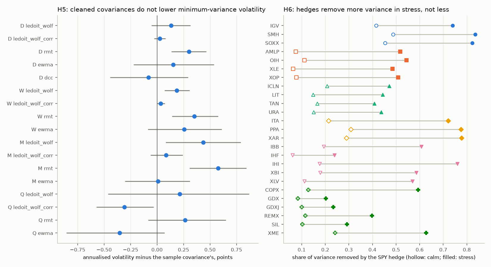
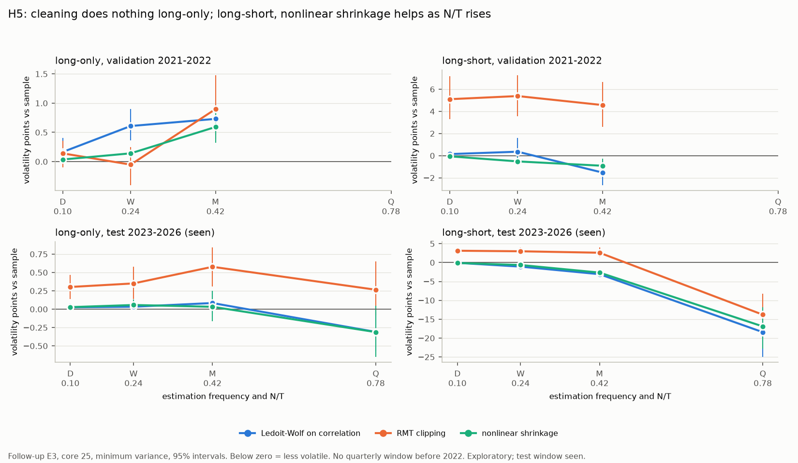

# 5. Cleaned covariances in minimum-variance portfolios (H5)

Phase 8 (`status/phase_8.md`, `docs/checks/8.5.md`) and follow-up E3 (`docs/FOLLOW_UPS_RESULTS.md`).

**Verdict: not supported** (test window 2023-2026, read once): cleaned covariances gave slightly *higher*
volatility. A follow-up shows the null is specific to the long-only design.

## 5.1 Setting

**H5 (pre-registered).** Shrinkage, RMT-cleaned and DCC-forecast covariance estimates give lower
out-of-sample realised volatility for minimum-variance portfolios than the raw sample covariance, especially at
monthly and quarterly horizons.

**Why it matters.** A minimum-variance portfolio depends only on the covariance matrix, so it is the cleanest
test of whether a better estimate of risk produces a less risky portfolio. The sample covariance is noisy when
the number of assets N is not small against the number of observations T, and the optimiser leans on exactly
the errors (it overweights pairs that look, by chance, negatively correlated).

**Design (declared 2026-10-11, before any portfolio was computed).** Core 25 funds, long-only, fully invested.
On the first session of each month a covariance is estimated from the trailing window of returns dated before
that day, at four frequencies: 252 days (N/T = 0.10), 104 weeks (0.24), 60 months (0.42), 32 quarters (0.78).
The portfolio is held to the next rebalance while weights drift. **Statistic:** mean over nine cells (three
cleaned estimators at each frequency where they exist) of [annualised realised volatility with the cleaned
estimator minus with the sample covariance], with a one-sided bootstrap p-value. Reported beside it: HRP
portfolios, costs of 0/5/10 basis points, Sharpe ratios, deflated Sharpe and the probability of backtest
overfitting.

## 5.2 Literature

- **Linear shrinkage.** Ledoit and Wolf (2004): the optimal convex combination of the sample covariance and a
  scaled identity, well conditioned and more accurate than the sample covariance in large dimensions.
- **Nonlinear shrinkage.** Ledoit and Wolf (2017) shrink each sample eigenvalue by its own amount and target
  portfolio selection; their 2020 paper gives an analytical formula based on a kernel estimate of the spectral
  density and its Hilbert transform.
- **Eigenvalue clipping.** Laloux et al. (1999) show that eigenvalues inside the Marchenko-Pastur band are
  indistinguishable from noise, and conclude that the smallest ones, which define the lowest-risk portfolios,
  make Markowitz optimisation on a historical matrix unreliable; the paper proposes no cleaning method. Plerou
  et al. (2002) filter by setting the noise eigenvalues to zero and the diagonal back to one. Replacing them by
  their average ("denoising", called RMT here) is a related variant; neither paper uses it.
- **The constraint already shrinks.** Jagannathan and Ma (2003) show that imposing no-short-sale constraints
  on a minimum-variance portfolio has the same effect as shrinking the extreme elements of the covariance
  matrix, which is why "the wrong constraints help". They also expect sampling error to matter less, and the
  constraint to hurt, when the assets are themselves large portfolios (p. 3-4 of the NBER version).
- **HRP.** López de Prado (2016) allocates by recursive bisection of a hierarchical clustering, without
  inverting the covariance; Monte Carlo experiments in the paper show lower out-of-sample variance than the
  critical-line optimiser.
- **Equal weight.** DeMiguel, Garlappi and Uppal (2009) find that none of 14 optimised models consistently
  beats 1/N out of sample because estimation error offsets the gain.
- **Backtest hygiene.** The deflated Sharpe ratio (Bailey and López de Prado 2014) corrects a Sharpe ratio for
  the number of strategies tried; the probability of backtest overfitting (Bailey et al. 2017) estimates how
  often the in-sample winner falls below the median out of sample.

## 5.3 Code

| Module | What it does |
|---|---|
| `evaluation/portfolio.py` | Estimators: `sample`, `ledoit_wolf` (scikit-learn), `ledoit_wolf_corr` (Ledoit-Wolf on standardised returns, sample volatilities kept), `rmt` (denoised correlation, sample volatilities), `ewma`, `dcc` (DCC correlation with EWMA variances); added for E3: `nonlinear`, `nonlinear_corr` (Ledoit-Wolf 2020, written here), `dcc_garch` (DCC correlation with GARCH variances). Portfolios: `minvar` (long-only, SLSQP), `hrp`, and for E3 `minvar_ls` (closed form, shorting allowed). The monthly walk-forward with drifting weights, the H5 statistic, costs, Sharpe, deflated Sharpe and PBO (`purgedcv`) |
| `evaluation/econ.py` | `etfcorr econ` (validation rehearsal) and `etfcorr econ --final --confirm-unseal` (the single test run) |
| `correlation/dcc.py` | Causal DCC path; exports the GARCH variance forecasts since E3 |

Minimum variance and HRP were written here with scipy because skfolio could not be imported at the time
(`cvxpy` missing). Since 2026-10-12 skfolio imports, and the HRP weights equal skfolio's to 1e-8 once both use
the same leaf ordering of the dendrogram (skfolio reorders leaves optimally; this project uses López de Prado's
original order, which gives weights up to 0.08 apart on a six-asset panel).

## 5.4 Scripts and results

### `etfcorr econ` (steps 8.3 and 8.3b): the validation rehearsal, 2021-2022

H5 statistic +0.0037 [+0.0022, +0.0052], cleaned estimators worse. One variant was declared after this
rehearsal and before it ran (tag `design-v4b-declared`): `ledoit_wolf` shrinks every variance towards the
average, unlike RMT and DCC, which keep the sample volatilities; `ledoit_wolf_corr` applies the shrinkage to
the correlation only. Its rule (lower volatility than `ledoit_wolf` with an interval below zero) was met,
-1.01 points [-1.26, -0.76], so it replaced `ledoit_wolf` in the H5 statistic. On the test window it was again
better than the original (-0.28 [-0.48, -0.07]), so the swap did not hide a result.

### `etfcorr econ --final --confirm-unseal` (step 8.5, run once by Filippo): the H5 verdict

*Figure: `scripts/figures_8_7.py`. Left: each cleaned covariance minus the sample covariance, minimum
variance, test window. Right: the hedging result of file 06.* `reports/tables/econ_8_final_{vol,backtest}.csv`.
931 days, 45 rebalances. Volatility points against the sample covariance:

| Frequency (rows) | Sample | LW on correlation | RMT | DCC |
|---|---|---|---|---|
| Daily (252) | 11.41% | +0.03 [-0.03, +0.08] | +0.30 [+0.14, +0.47] | -0.08 [-0.44, +0.29] |
| Weekly (104) | 11.45% | +0.03 [-0.00, +0.07] | +0.35 [+0.14, +0.58] | |
| Monthly (60) | 12.29% | +0.08 [-0.06, +0.24] | +0.58 [+0.31, +0.84] | |
| Quarterly (32) | 13.64% | -0.31 [-0.57, -0.03] | +0.27 [-0.08, +0.65] | |

**H5 statistic +0.0014 [+0.0005, +0.0023], one-sided p = 0.997. Not supported, opposite sign.** Monthly and
quarterly cells minus daily: +0.07 [-0.08, +0.22], so "especially at monthly and quarterly horizons" is not
seen either. Equal weight ran at 18.86%.

Beside the verdict: for HRP, EWMA lowers volatility at every frequency and RMT at monthly and quarterly
(-0.37, -0.69 points), with intervals excluding zero (RMT's daily and weekly intervals include it). Turnover 1.7 per year for the sample covariance, 7.5 for DCC. Sharpe ratios 1.0-1.3 with
a standard error of 0.52, none distinguishable (a rising market over 3.7 years); PBO across cells 0.80.

### `scripts/followup_h5.py` (follow-up E3): settings where cleaning can matter

`reports/tables/followup_h5_{cells,pooled}.csv`. The long-only core rows reproduce +0.0014 [+0.0005, +0.0023]
exactly, and the DCC path matches the one of step 8.5. Volatility points against the sample covariance:

| Setting | Validation 2021-2022 | Test 2023-2026 (seen) |
|---|---|---|
| Long-only, nonlinear shrinkage | +0.26 [+0.15, +0.36] | -0.05 [-0.20, +0.12] |
| **Long-short, nonlinear shrinkage** | **-0.50 [-0.73, -0.27]** | **-5.1 [-6.7, -3.6]** |
| Long-short, the declared three (LW-corr, RMT, DCC) | +1.95 [+1.35, +2.66] | -3.1 [-4.7, -1.7] |
| Long-short, 41 funds, nonlinear | -0.09 [-0.27, +0.12] (daily only) | -0.87 [-1.07, -0.65] |
| Full DCC-GARCH, long-only | +0.17 [-0.32, +0.66] | +0.12 [-0.16, +0.40] |

*Figure: `scripts/figures_explained.py`, from `followup_h5_cells.csv`, core 25. Each panel has its own vertical
scale. Top row: validation; bottom row: test window (seen). Left: long-only; right: long-short.*

Long-short nonlinear shrinkage by frequency on the test window: -0.1 (N/T 0.10), -0.7 (0.24), -2.7 (0.42),
-17 (0.78) points. In the quarterly cell the sample-covariance long-short portfolio runs 12 times gross leverage
and 31% volatility. RMT clipping in long-short portfolios is 2.6 to 5.4 points *worse* than the sample
covariance at daily, weekly and monthly frequencies, in both windows.

### `scripts/replication_pre2014.py` (E6): the same test on 2008-2013

Declared and tagged before the download, run once on 2026-11-01 (`docs/REPLICATION_PRE2014_RESULTS.md`). The 13
core funds that traded by mid-2006; only the daily and weekly cells fit the data, and all five of them (the
three cleaned estimators) exist from 2008-07-01, when the weekly window and the DCC first have enough history.
Cleaned minus sample: **+0.17 points [+0.04, +0.31]**, one-sided p = 0.994. Not supported, with the same sign
and size as H5 (+0.14 [+0.05, +0.23]).

### `scripts/holdout_e10.py` (E10): the forward hold-out of E3, declared, not run

The long-short nonlinear-shrinkage result of E3 is declared as E10 and tagged (`e10-holdout-freeze-v1`): the
statistic of E3 on 2026-10-01 to 2027-09-30, a window with no price on disk when it was declared. The script
refuses to run before 2027-10-07.

## 5.5 Interpretation

**Long-only: the constraint does the work.** Every estimator lands within a few tenths of a point of the
sample covariance, and the pooled difference is slightly positive. This is what Jagannathan and Ma (2003)
predict: forbidding short positions caps the damage of extreme covariance estimates, so there is little left
for cleaning to fix. With 25 funds and 252 daily rows (N/T = 0.10), the sample covariance is also an easy case,
and each fund is itself a diversified basket, the case where Jagannathan and Ma expect sampling error to matter
least. Ledoit and Wolf (2017) ran the long-only check on US stocks (their Table 8, p. 27): the sample covariance
was uniformly the best rotation-equivariant estimator, by small margins, and the constraint hurt both linear and
nonlinear shrinkage. Our long-only result is the same finding on thematic ETFs.

**Long-short: shrinkage helps, and the more so the higher N/T.** Without the constraint, estimation error is
exposed and nonlinear shrinkage lowers volatility in both windows, with a gain that grows from 0.1 points at
N/T = 0.10 to 17 points at 0.78. Ledoit and Wolf (2017) ran almost the same backtest (unconstrained minimum
variance, 250 daily rows, monthly updates) on US stocks, 1973-2011, and report gains of 0.13, 0.47 and 1.59
points at N = 30, 50 and 100 (N/T = 0.12, 0.20, 0.40; their Table 1, p. 22 of the authors' copy), against our
0.11, 0.65 and 2.66 at N/T = 0.10, 0.24, 0.42: the same pattern and order of magnitude, ours 40-70% larger
above the daily row (they raise N/T by adding assets, we by using lower-frequency returns). Jagannathan and Ma
(2002) found that, with short sales allowed,
the daily sample covariance already does best (p. 7 of the NBER version), which matches our tiny daily gain. The big
pooled test-window number is mostly the quarterly cell.

**Clipping is the wrong cleaner for an unconstrained optimiser.** Replacing all noise-band eigenvalues by their
average flattens the small eigenvalues the long-short portfolio relies on, so it takes positions that look
riskless and are not. Nonlinear shrinkage moves each eigenvalue by its own amount and avoids that. This is an
inference from the result, not tested directly.

**Time-varying models did not help.** Neither DCC with EWMA variances nor the full DCC-GARCH covariance beat
the sample covariance. Both use one-day-ahead forecasts for a portfolio held a month, a mismatch noted but not
tested.

**Equal weight was far riskier** (18.9% against 11.4%), so optimisation did reduce risk; what it did not need
was a cleaned covariance. On return-based criteria DeMiguel et al. (2009) find 1/N hard to beat; for pure risk
reduction, minimum variance clearly beat it here.

## 5.6 Limits

- One test window, mostly a rising, low-volatility market; quarterly cells ran for the first time in the final
  run.
- Long-short portfolios ignore borrow costs and leverage limits (2.5 to 12 times gross); they say something
  about estimators, not about a tradeable strategy.
- E3 compares dozens of cells without correction, partly on the seen window.
- The larger panel has 41 funds, not 47: the common history of all 47 starts in 2024, and the two spot-crypto
  series are not ETFs.
- Sharpe ratios are reported because the plan asks for them; they are not results.
