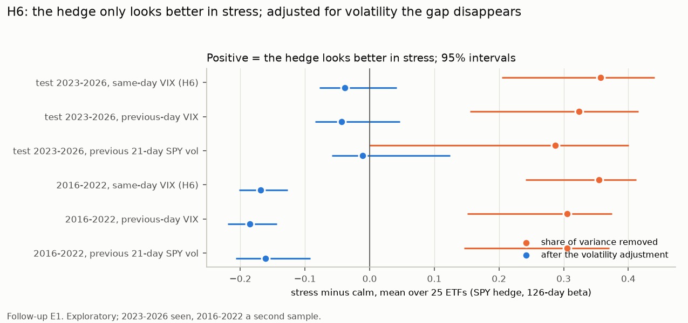
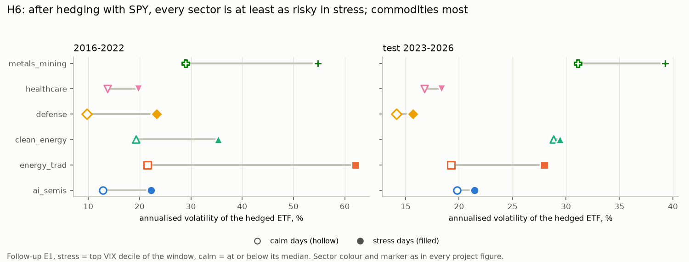

# 6. Hedging with SPY in stress and in calm (H6)

Phase 8 (`status/phase_8.md`, `docs/checks/8.5.md`) and follow-up E1 (`docs/FOLLOW_UPS_RESULTS.md`).

**Verdict: not supported** (test window 2023-2026, read once): the hedge removed a *larger* share of variance in
stress. A follow-up shows this is the H2 volatility effect, not a better hedge.

## 6.1 Setting

**H6 (pre-registered).** Hedge effectiveness (variance reduction) is lower in the worst-decile stress periods
than in calm periods.

**Why it matters.** The usual worry is that hedges fail when they are needed: correlations shift, betas move,
and a hedge sized in calm markets under-protects in a sell-off. If that were true for thematic ETFs hedged with
the S&P 500, a manager would need a different instrument or a regime-aware hedge ratio.

**Design (declared 2026-10-11, before any hedge was computed).** Each of the 25 core funds is hedged with SPY.
Hedge ratio: OLS beta over the trailing 126 sessions ending the day before. Hedged return:
`r_i,t - beta_i,t-1 * r_SPY,t`. Effectiveness in a set of days: `1 - Var(hedged) / Var(unhedged)`. Stress: days
whose VIX close is above the 90th percentile of the evaluated window; calm: at or below the median.
**Statistic:** mean over the 25 funds of [effectiveness in stress - in calm]; H6 needs it negative with a
one-sided p below 0.05. Reported beside it: EWMA and static betas, and a sparse (lasso) hedge on six
instruments (SPY, QQQ, IWM, TLT, GLD, HYG) refitted monthly.

## 6.2 Literature

- **Hedge effectiveness.** Ederington (1979) defined it as the percentage reduction in the variance of the
  hedged position against the unhedged one, with the minimum-variance (OLS) hedge ratio; it remains the
  standard criterion.
- **Why effectiveness tracks correlation.** For one instrument and the right beta, effectiveness equals the
  squared correlation between the asset and the hedge. Anything that raises measured correlation raises
  measured effectiveness.
- **The volatility bias.** Forbes and Rigobon (2002): correlation measured in high-volatility periods is biased
  upwards when the underlying relationship is unchanged. Selecting days by a high VIX selects high-volatility
  days. Longin and Solnik (2001) make the related point that correlations conditioned on large moves differ
  from unconditional ones.
- **EWMA beta.** The RiskMetrics (1996) recursion applied to the cross moment and the hedge's variance.

## 6.3 Code

| Module | What it does |
|---|---|
| `evaluation/hedging.py` | Rolling, EWMA and static betas; the monthly lasso hedge (`LassoCV` with time-ordered folds, fitted on data before each rebalance); `regime_masks`; effectiveness; `h6_table` (the statistic and its bootstrap). Added for E1: `regime_risk` (per fund and regime: effectiveness, squared correlation raw and Forbes-Rigobon adjusted, annualised volatility, 5% value at risk and expected shortfall, hedged and unhedged) and `regime_risk_table` (means with bootstrap intervals) |
| `evaluation/econ.py` | Runs the hedges inside `etfcorr econ` and `econ --final` |
| `correlation/regime_correlation.py` | `forbes_rigobon_adjust`, shared with H2 |

## 6.4 Scripts and results

### `etfcorr econ` (step 8.3): the validation rehearsal, 2021-2022

Difference +0.202, one-sided p = 0.99: already the opposite sign of H6.

### `etfcorr econ --final --confirm-unseal` (step 8.5, run once by Filippo): the H6 verdict

`reports/tables/econ_8_final_{hedge,hedge_assets,lasso_selected}.csv`. 93 stress days, 468 calm days.

| Hedge | All days | Stress | Calm | Stress - calm |
|---|---|---|---|---|
| **Rolling beta (verdict)** | 0.31 | **0.54** | **0.19** | **+0.357 [+0.205, +0.441]** |
| EWMA beta | 0.30 | 0.53 | 0.18 | +0.35 [+0.19, +0.43] |
| Static beta | 0.25 | 0.48 | 0.14 | +0.34 [+0.13, +0.44] |
| Lasso on six instruments | 0.47 | 0.60 | 0.40 | +0.21 [+0.09, +0.26] |

**p = 1.000. Not supported, opposite sign**, for all 25 funds and all four hedges. The lasso hedge is better in
every regime: IWM is chosen for 93% of fund-months, GLD 74%, QQQ 72%. The right panel of
`reports/figures/h5_h6_8_7.png` (shown in file 05) plots each fund's effectiveness in calm and in stress.

### `scripts/followup_h6.py` (follow-up E1): remove the bias, report what is left

`reports/tables/followup_h6_{summary,sectors}.csv`. The script reproduces +0.357 exactly, then changes one thing
at a time.

**Stress label from information known beforehand, and the volatility adjustment** (gap = stress - calm):

| Stress label | Window | Gap in variance removed | Gap after Forbes-Rigobon adjustment |
|---|---|---|---|
| same-day VIX (H6 design) | 2023-2026 | +0.357 [+0.205, +0.441] | -0.038 [-0.077, +0.042] |
| previous-day VIX | 2023-2026 | +0.324 [+0.155, +0.416] | -0.043 [-0.085, +0.046] |
| previous 21-day SPY volatility | 2023-2026 | +0.287 [-0.001, +0.400] | -0.011 [-0.059, +0.125] |
| same-day VIX | 2016-2022 | +0.355 [+0.241, +0.412] | -0.168 [-0.202, -0.127] |
| previous-day VIX | 2016-2022 | +0.306 [+0.151, +0.374] | -0.186 [-0.219, -0.143] |

*Figure: `scripts/figures_explained.py`, from `followup_h6_summary.csv`.*

The adjusted gap compares the stress correlation with SPY, adjusted to the calm variance of SPY and squared,
against the squared calm correlation.

**What is left after hedging** (means over the 25 funds, same-day VIX label):

| | 2023-2026 stress | 2023-2026 calm | 2016-2022 stress | 2016-2022 calm |
|---|---|---|---|---|
| Hedged volatility (annualised) | 26.7% | 22.6% | 38.2% | 18.9% |
| Expected shortfall of a hedged fund, worst 5% of days | 3.8% | | 5.6% | |
| Same, unhedged | 5.9% | | 9.6% | |

*Figure: `scripts/figures_explained.py`, from `followup_h6_sectors.csv`, same-day VIX label. Each panel has its
own horizontal scale.*

**By sector** (2016-2022, hedged volatility in stress): energy 62%, metals and mining 55%, clean energy 35%,
defence 23%, semiconductors and software 22%, healthcare 20%. In calm markets of 2016-2022 SPY removes only
10-17% of the variance of energy and miners (`followup_h6_sectors.csv`).

### `scripts/replication_pre2014.py` (E7): the same test on 2007-2013

Declared and tagged before the download, run once on 2026-11-01 (`docs/REPLICATION_PRE2014_RESULTS.md`). The 13
core funds that traded by mid-2006; stress is the top VIX decile of 2007-07-02 to 2013-12-31 (164 days).

| | Removed in stress | Removed in calm | Gap | Hedged volatility, stress / calm |
|---|---|---|---|---|
| E7, 2007-2013 | 0.730 | 0.524 | +0.207 [+0.120, +0.267] | 32% / 14% |
| H6, 2023-2026 | 0.54 | 0.19 | +0.357 [+0.205, +0.441] | 27% / 23% |

Not supported, with the same sign as H6, for all 13 funds. After the Forbes-Rigobon adjustment the gap in
squared correlation is -0.37 [-0.42, -0.28], but SPY's variance in stress is 21 times its calm level and the
same adjustment over-corrects in E5 (see Corsetti et al. in file 08), so this is not read as support for H6.

## 6.5 Interpretation

**The hedge is not better in stress; the market is louder.** A single-instrument hedge removes roughly the
squared correlation with the hedge. In high-VIX days correlation with SPY is higher, by the Forbes and Rigobon
(2002) mechanism already measured in H2, so the measured share removed is higher. Adjusting for the louder
market brings the gap to about zero on 2023-2026 and below zero on 2016-2022, where the link to SPY was weaker in
stress once volatility is accounted for.

**Lagging the label barely helps.** Using yesterday's VIX or last month's SPY volatility leaves the gap at +0.32
and +0.29, because volatility is persistent: yesterday's high VIX still picks today's loud days. The bias comes
from conditioning on volatility at all, not from using same-day information.

**What a hedger should look at is leftover risk.** Even with 54% of variance removed, hedged positions were more
volatile on stress days (27% against 23%; 38% against 19% in 2016-2022), and their worst days were still large.
"54% removed in stress" should not be quoted as hedge quality.

**SPY is a poor stress hedge for commodity sectors.** Energy and miners keep 55-62% volatility after hedging in
stress. A multi-instrument hedge did better in every regime (the lasso picks small caps, gold and the Nasdaq),
which points to sector-specific hedges as the practical next step.

**Ederington's measure is still the right one; it just answers a narrower question.** Variance reduction says
what share of risk a hedge removes, not how much risk remains. In regimes whose variances differ by a factor of
several, both numbers are needed.

## 6.6 Limits

- Stress is 93 days in a few clusters (177 in 2016-2022); the 21-day bootstrap blocks understate the
  uncertainty from so few episodes, and the 5% tail rests on four or five days per fund.
- Stress and calm thresholds are quantiles of the evaluated window (ex-post); only the information in the label
  is lagged in E1.
- Close-to-close prices, no costs, no margin.
- E1 was run on the seen window; 2016-2022 is a second sample, not a hold-out.
